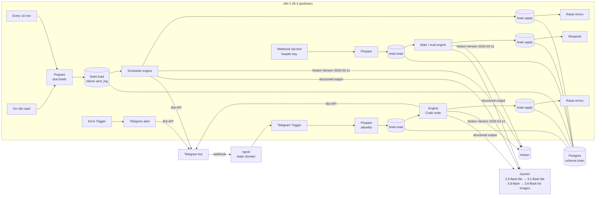

# Second Brain Bot

One private Telegram bot on a self-hosted n8n that turns text, voice notes, receipt photos/PDFs and photos of handwritten notes into Notion rows: **Expenses / Incomes / Transfers**, **✅ To-Do**, **Notes** and the **Brain Dump** page.

- Finance is **never written before you tap ✅**. Tasks, notes and brain-dump items are saved at once, with ✏️ / ↩️.
- One message can hold several things: `payé 4€ café, rappelle-moi la CAF lundi, idée: agent LinkedIn vidéo` → 1 expense (waiting for ✅) + 1 task + 1 idea.
- Prefixes skip the router: `$` finance · `!` task · `#` note · `?` brain dump · `@` talk.
- **Conversation**: questions about your data (« combien en resto ce mois ? »), thinking out loud, or answering a ❓ clarify question. Short replies (≤ 3 sentences, 1 question), wraps up after 6 exchanges or 30 min of silence, and proposes what to save as buttons (nothing is saved without a tap).
- Commands: `/today` `/month` `/undo` `/cards` `/help` (help is pinned).
- Briefs: 08:00 morning, 21:00 evening check-in, Sunday 20:00 weekly. Briefs missed while the laptop was off are sent at the next run the same day.

## Architecture

Message flow inside the engine: **pre-process** (voice → transcript, photo/PDF → receipt / note / other) → **route** (prefix or LLM router, < 0.6 confidence → 4 type buttons) → **extract** (one prompt + response schema per type, live option lists cached 1 h) → **validate** (rules + duplicate check) → **save** instant items / park finance in `brain.pending` → **one recap message**, edited in place by every button.

Why Code nodes call the APIs directly: Code nodes can't use n8n credentials (`httpRequestWithAuthentication` isn't supported there), so they read 3 tokens from env vars (`$env`). A pure node graph would need hundreds of nodes for ~15 button actions. All state goes through two SQL functions: `brain.load(jsonb)` reads everything an execution needs and atomically claims a button token, and `brain.apply(jsonb)` writes everything back in one transaction. The workflow JSON holds no secrets.

## Repository

| Path | What |
|---|---|
| `prompts/*.md` | Router + 4 extractor system prompts, few-shots, response schemas: **the source of truth** (build.py compiles them) |
| `src/*.js` | Bot library: core/Telegram/dates · Gemini + option lists · extract/validate · Notion writes · recap renderer · main engine · scheduler + eval. `05_prompts.js` is generated. |
| `config.example.json` | Template for `config.local.json`: chat id, Notion ids, n8n credential ids (never committed) |
| `build.py` | Builds the library, syntax-checks it, writes `workflows/*.json`, `--deploy` creates/updates + activates via the n8n API |
| `workflows/` | Exported workflows (no secrets): SB · Main, SB · Scheduler, SB · Test API, SB · Error |
| `migrations/002_chat.sql` | Lets `chat_state` hold an open conversation (`awaiting = 'chat'`) |
| `migrations/001_init.sql` | Schema `brain`: pending, callbacks, chat_state, card_map, sent_log, bot_log, cache, config + `load()` / `apply()` |
| `tests/unit.test.mjs` | Offline tests of the deterministic logic (`node --test tests/unit.test.mjs`) |
| `tests/fixtures.jsonl` | 66 labelled cases + 5 receipt-photo slots |
| `scripts/eval.py` | Router accuracy + confusion matrix, per-field accuracy, latency, cost |
| `scripts/harness.py` | Test helpers that drive the real engine through SB · Test API: send messages, tap buttons, query Postgres/Notion (real Telegram messages, real Notion rows) |
| `scripts/report.sql` | Real-use quality from `bot_log`: saved-without-edit share, most-edited fields, undo rate, cost |

## Setup (from scratch)

1. **Bot**: create it with BotFather, add the token in n8n as a Telegram credential, open the bot and press **Start** (bots can't message you first).
2. **Secrets for Code nodes**: add `SB_NOTION_TOKEN`, `SB_GEMINI_API_KEY`, `SB_TELEGRAM_TOKEN` to `~/n8n/.env` (mode 600). `compose.yaml` passes them to n8n with `N8N_BLOCK_ENV_ACCESS_IN_NODE=false`. Then `cd ~/n8n && podman-compose up -d n8n`.
3. **DB**: `for f in migrations/*.sql; do podman exec -i n8n_postgres_1 psql -U n8n -d n8n -v ON_ERROR_STOP=1 < $f; done`
4. **n8n credentials**: `SB Postgres` (host `postgres`, db/user from `~/n8n/.env`), `SB Test API key` (Header Auth, name `X-SB-Key`). Copy `config.example.json` to `config.local.json` (git-ignored) and fill in your chat id, the Notion data-source ids (incl. `learning` = Learning Library) and these credential ids. `build.py --deploy` injects them; the exported `workflows/*.json` keep `__SB_*__` placeholders.
5. **Deploy**: `cp .env.example .env`, fill it in, then `python3 build.py --deploy`. Activating SB · Main registers the Telegram webhook through `WEBHOOK_URL` (ngrok).
6. **Check**: `node --test tests/unit.test.mjs`, `python3 scripts/eval.py`, then send `/help` to the bot.

Change a prompt: edit `prompts/<type>.md`, run `python3 scripts/eval.py --stage <type>`, then `python3 build.py --deploy`.

## Behaviour notes

- **Accounts**: `ESPÈCES`/cash → Cash Wallet. `épargne`/savings → Savings Account. A card's last 4 digits are looked up in `brain.card_map`; an unknown card asks once with account buttons and is remembered (`/cards` to view, `/cards 1234 Revolut` to set). No ✅ button until every line has its account(s).
- **Receipts**: one row per category, items in the page body. Σ items ≠ printed total ±0.05 € → confidence ≤ 0.5 + ⚠️.
- **New category**: shown as 🆕 in the recap. Tapping ✅ creates it in Categories (with no budget).
- **Budgets**: computed from Notion (Categories `Expense This Month` rollup vs `Monthly Budget`). 0 € budget → "pas de budget". ⚠️ at ≥ 80 %, 🚨 at ≥ 100 %.
- **Tasks**: the LLM resolves dates against an explicit calendar list ("avant X" = X − 1). Priority is computed in code from the due date + an `urgent` flag (admin procedure with a date, or explicit urgency). A goal is linked at ≥ 0.7 confidence, otherwise suggested as a 🎯 button. A past due date is dropped with a warning unless you said it was past.
- **Brain Dump**: inserted after the section's last to-do (Notion `position: after_block`). The template placeholders stay. ↩️ deletes the block.
- **Conversation** (`src/55_chat.js`, `prompts/chat.md`): the router's `chat` type (or `@`) opens it; while it is open, text and voice go to the conversation first and the model hands real captures back (`action: capture`) to the normal pipeline. One Gemini call per turn, plus one more only when it asks for a Notion lookup (open tasks, expenses/incomes by period and category, keyword search in notes / tasks / brain dump). Budgets and goals come from the 1 h list cache. History (last 6 exchanges) lives in `chat_state.ref`.
- **Learning Library**: a note or idea that is a resource to learn from (video, course, article, book, podcast, website; `learning` flag set by the note / brain-dump extractor) is saved as usual and gets a 📚 button. One tap creates a Learning Library row (name, Type and Category from the live options, Status Not started, the link in Files & media, like the rows made by hand) and removes the original. ↩️ trashes the new row.
- **All of Notion in chat**: the conversation's search covers every page the integration can see (finance rows excluded, they have their own lookups). A page it can't see must be shared once in Notion: ••• → Connections.
- **Clarify**: an item under 0.6 router confidence gets the router's ❓ question as text next to the 4 type buttons; a text answer re-extracts it with that type (same path as the button).
- **Idempotency**: buttons carry only `cb:<token>`. A tap claims its token atomically in Postgres, and batch-changing actions (✅ ❌ 🗑 ↩️ …) also burn their siblings, so double taps and ✅-then-❌ do nothing the second time.
- **Notion down**: an item that fails with 429/5xx/network is kept as `failed` in its batch (status `retrying`) and retried every 10 min. The recap message updates when it goes through.
- **Finance batches**: reminder after 12 h, expired (cancelled) after 48 h.
- **Gemini free tier**: 15 requests/min **per model**. On 429 the next model takes over. Cost columns use paid-tier prices so you can see what it would cost (≈ 0.5 m€ per call).
- **Logging**: `brain.bot_log` holds one row per LLM call / extracted item, with tokens, cost, latency, confidence and was_edited / edited_fields / was_cancelled / was_undone. Eval runs are not logged.
- **Errors**: anything that throws → SB · Error sends you the workflow, the node / stage and the message. The ⏳ message of the failing batch also shows ❌.

## Known limits (shortcuts)

- "Tasks done this week" in the weekly review = Done + edited this week (Notion has no status-change date).
- Morning brief at 22:00 after a full day off still sends the morning brief (spec: send what was missed today), then the evening one.
- Telegram files > 20 MB are refused (Bot API limit; the DMS worker's MTProto path isn't used here).
- Brain-dump "captured yesterday/this week" comes from Notion block creation times, so it also counts items added by hand.
